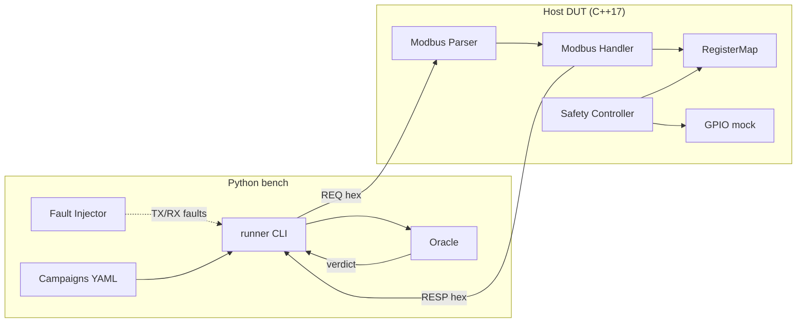
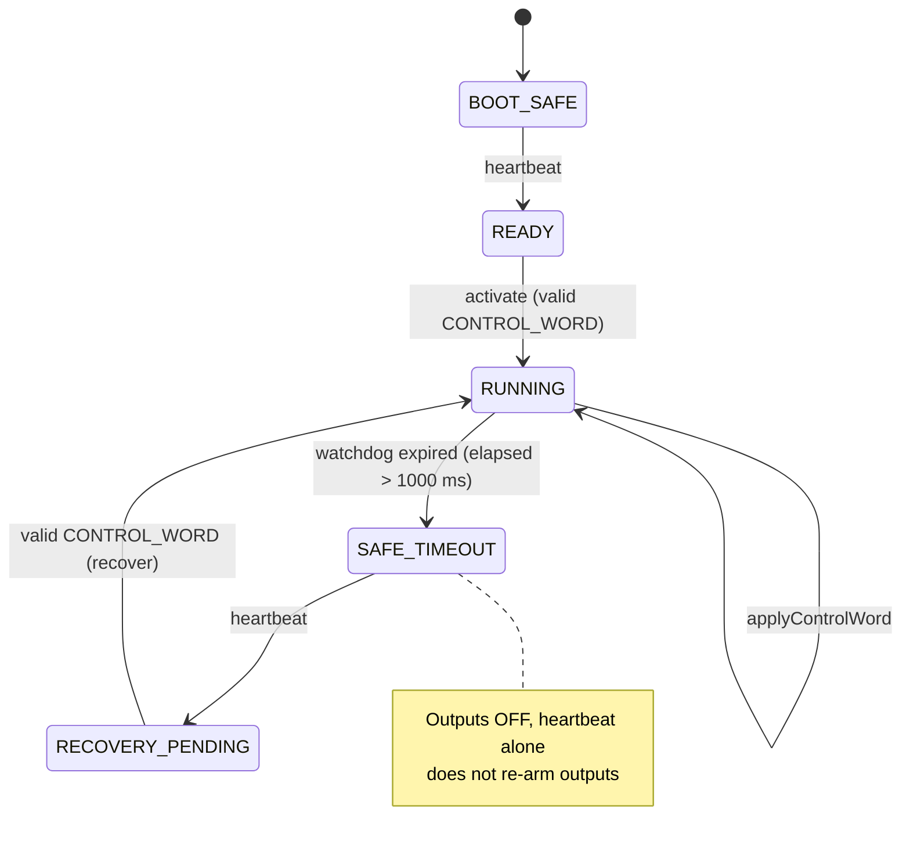

# RTU-FaultLab

> **SIL validation bench for embedded Modbus RTU firmware — deterministic, traceable, hardware-free.**

[](https://github.com/mael51/RTU-FaultLab/actions/workflows/ci.yml)
[](https://github.com/mael51/RTU-FaultLab/releases)
[](LICENSE)


**RTU-FaultLab** is an automated validation bench for an embedded controller
communicating over **Modbus RTU**. The firmware runs on a host (SIL) driven by a
Python/Pytest bench that injects deterministic faults and verifies the expected
behavior with requirement-to-test traceability.

**Why this project?** Validating embedded firmware usually requires a physical board,
RS-485 wiring and manual testing. RTU-FaultLab moves that validation into simulation:
same business code, same scenarios, reproducible results in CI, no hardware. The STM32
port is prepared (stubs + guide) but deliberately not advertised as validated.

## Key figures

| | |
|---|---|
| C++ tests | **57** (GoogleTest, ASan/UBSan/TSan) |
| Python tests | **33** (Pytest) |
| Campaign scenarios | **7 smoke + 12 robustness** |
| Fault injections | **7** (5 TX + 2 RX), deterministic by seed |
| Coverage | lcov 2.x capture, filtered, verified non-empty |
| CI | 4 jobs green on the tagged SHA (`v1.0.0`) |

## Architecture (SIL)



- **Firmware**: portable C++17, Modbus RTU (FC03 read, FC06 write), CRC16,
  safety state machine (BOOT_SAFE → READY → RUNNING → SAFE_TIMEOUT → RECOVERY_PENDING),
  centralized output application.
- **Bench**: Python/Pytest, CLI runner, YAML campaigns, deterministic injection by seed,
  strict oracle (CRC including exceptions, unknown state ≠ PASS, late responses purged).
- **Host DUT**: stdin/stdout process, bounded queue, strict hex decoding, clean shutdown.

### Safety state machine



## Status

- **Validated (SIL)**: Modbus RTU core, safety controller, host DUT, virtual transport,
  TX/RX injections, oracle, traceability, campaigns, full CI.
- **Not validated**: physical STM32 / RS-485 port (architecture prepared, stubs + guide).
  No hardware validation is claimed until on-board tests are performed.

## Quick start

```bash
# 1. Build
cmake -G Ninja -S . -B build
cmake --build build --parallel

# 2. C++ tests
cd build && ./rtufaultlab_tests   # .exe on Windows

# 3. Python tests
pip install pytest pyyaml
python -m pytest tests/integration tests/unit/test_bench_runner.py -q

# 4. Campaigns
python bench/runner/cli.py bench/campaigns/smoke.yaml \
  --dut build/rtufaultlab_dut_host.exe --reports bench/reports
python bench/runner/cli.py bench/campaigns/robustness.yaml \
  --dut build/rtufaultlab_dut_host.exe --reports bench/reports

# 5. Demo
python bench/demo.py
```

> On Windows (MSYS2/UCRT64), prepend `C:\msys64\ucrt64\bin` to `PATH` for the
> compiler DLLs. If the DUT fails to start, the runner prints an explicit diagnostic.

## Fault injection

Each fault declares its **point of application**: TX (request PC → DUT) or RX
(response DUT → PC). All injections are deterministic (seed) and verified: the runner
rejects a scenario whose configured fault was not actually applied.

| Fault | Point | Observable effect |
|---|---|---|
| `drop` | TX | request never reaches the DUT → timeout |
| `delay_ms` | TX | request delayed; beyond timeout → timeout |
| `duplicate` | TX | request sent twice |
| `corrupt_crc` | TX | invalid CRC → frame rejected by the DUT |
| `truncate` | TX | incomplete frame → rejected without crash |
| `drop_response` | RX | request reaches the DUT, response lost; DUT effect still verifiable |
| `delay_response_ms` | RX | response arrives late; beyond timeout → timeout |

Limits: logical injection at IPC level (host DUT stdin/stdout), no electrical RS-485
injection; one fault per scenario; after a timeout, any late response is purged before
the next request (resync).

## Documentation

- `docs/README.md` — phase plan
- `docs/SPEC.md` — specification
- `docs/hardware_guide.md` — STM32 port
- `CHANGELOG.md` — release history

## V1.0 scope

- **Simulated (SIL)**: host firmware, virtual transport, fault injection,
  safety controller, traceability, CI.
- **Hardware**: optional STM32 port, not validated without a board.
- **Out of scope**: CAN/CAN-FD, GUI, electrical injection, certification
  (DO-178C, MISRA, IEC 61508).

## License

MIT — see [LICENSE](LICENSE).