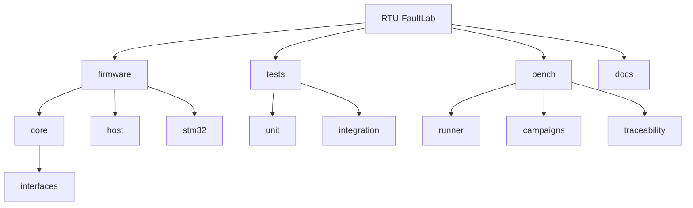

# Phase 0 - Mise en place de l'environnement (Documentation détaillée)

**Statut** : ✅ Validée
**Date** : 11 Novembre 2026
**Tests** : 2/2 passés

---

## 📋 Table des matières

1. [Objectif](#objectif)
2. [Outils requis](#outils-requis)
3. [Structure du projet](#structure-du-projet)
4. [Fichiers créés](#fichiers-créés)
5. [Compilation](#compilation)
6. [Tests](#tests)
7. [Ce qu'on a appris](#ce-quon-a-appris)
8. [Prochaines étapes](#prochaines-étapes)

---

## Objectif

Mettre en place l'environnement de développement pour RTU-FaultLab : compilateur C++ (MinGW), CMake, GoogleTest, Python/Pytest, structure de projet portable (cœur firmware + adapters + banc de test) et build hôte fonctionnel.

## Pourquoi cette phase ?

Sans un environnement de build reproductible et une structure claire, il est impossible de compiler, tester et faire évoluer le firmware. Cette phase pose les fondations : un seul point d'entrée CMake, des bibliothèques séparées (core/host), et des tests automatisés.

## Concepts clés en détail

### CMake et FetchContent

`FetchContent` permet de télécharger GoogleTest automatiquement lors de la configuration. Cela évite d'installer manuellement les dépendances et garantit la même version pour tous les contributeurs.

```cmake
include(FetchContent)
FetchContent_Declare(googletest URL https://github.com/google/googletest/archive/refs/tags/v1.14.0.zip)
set(gtest_force_shared_crt ON CACHE BOOL "" FORCE)
FetchContent_MakeAvailable(googletest)
```

### Bibliothèques statiques vs dynamiques

Les bibliothèques `rtufaultlab_core` et `rtufaultlab_host` sont statiques (`STATIC`). Elles sont liées au binaire de test et à l'exécutable DUT host. Cela simplifie le déploiement (un seul binaire).

### Distinction MSYS vs MinGW

- `/usr/bin/gcc` : compilateur MSYS2 (POSIX, nécessite `msys-2.0.dll`).
- `/mingw64/bin/gcc` : compilateur MinGW (natif Windows, pas de dépendance DLL supplémentaire au runtime, mais utilise `libstdc++-6.dll` et `libgcc_s_seh-1.dll`).

Pour éviter les erreurs `fdopen`/`mkstemp` non déclarés, il faut utiliser le compilateur MinGW.

## Erreurs courantes

- **CMake choisit le mauvais compilateur** : forcer le PATH avec `C:\msys64\mingw64\bin` en premier.
- **`add_library(... STATIC)` sans sources** : erreur CMake. Ajouter un fichier placeholder.
- **Binaire ne démarre pas** : ajouter `C:\msys64\mingw64\bin` au PATH pour résoudre les DLL.

---

## Outils requis

### Sur PC (Windows)
- **CMake** >= 3.16 (utilisé : 4.4.2)
- **GCC/G++ MinGW** >= 13.0 (utilisé : 13.3.0, `C:\msys64\mingw64\bin`)
- **GoogleTest** 1.14.0 (téléchargé automatiquement par CMake via FetchContent)
- **Python 3** >= 3.10 (utilisé : 3.14.6) + `pytest`, `pyyaml`
- **clang-format** 11.0.0
- **Git**

### Pour STM32 (phase 10+)
- **arm-none-eabi-gcc**, **STM32CubeMX**, **ST-Link / OpenOCD**

---

## Structure du projet



```
RTU-FaultLab/
├── firmware/
│   ├── core/                 # Cœur portable C++17 (parser, registres, sécurité)
│   │   ├── interfaces/       # IClock, IGpio, IByteTransport (phases suivantes)
│   │   ├── core_placeholder.cpp
│   │   └── (à venir)
│   ├── host/                 # Adapter hôte (transport virtuel, GPIO mock, horloge)
│   │   ├── host_placeholder.cpp
│   │   └── (à venir)
│   └── stm32/                # Adapter STM32 (HAL UART, GPIO, FreeRTOS) — phase 10
├── tests/
│   ├── unit/                 # Tests GoogleTest (C++)
│   │   └── test_phase0.cpp
│   └── integration/          # Tests Python/Pytest (campagnes)
├── bench/
│   ├── runner/               # CLI Python, moteur d'injection de défauts
│   │   └── reporters/
│   ├── campaigns/            # Scénarios YAML
│   └── traceability/         # Matrice exigences ↔ tests
├── docs/                     # Documentation par phase + spec
├── .github/workflows/        # CI (phase 9)
├── CMakeLists.txt
├── .clang-format
└── README.md
```

---

## Fichiers créés

| Fichier | Rôle |
|---|---|
| `CMakeLists.txt` | Build host, FetchContent GoogleTest, libs core/host, tests, option sanitizers, warnings |
| `firmware/core/core_placeholder.cpp` | Source placeholder pour la lib `rtufaultlab_core` |
| `firmware/host/host_placeholder.cpp` | Source placeholder pour la lib `rtufaultlab_host` |
| `tests/unit/test_phase0.cpp` | 2 tests de fumée (compilation + exécution) |
| `.clang-format` | Style Google, indent 4, colonne 100 |
| `README.md` | Présentation, build, tests, liens docs |
| `docs/README.md` | Index des phases et statuts |

---

## CMakeLists.txt — points clés

- `cmake_minimum_required(VERSION 3.16)`, projet `RTU-FaultLab` en C++17.
- Warnings : `/W4` (MSVC) ou `-Wall -Wextra -Wpedantic` (GCC/Clang).
- Option `RTU_ENABLE_SANITIZERS` (ASan/UBSan) pour les phases ultérieures.
- GoogleTest 1.14.0 via `FetchContent` (zip GitHub), `gtest_force_shared_crt ON` pour MinGW.
- `enable_testing()` + `gtest_discover_tests(rtufaultlab_tests)`.
- Les bibliothèques core/host sont `STATIC` et exposent leurs headers via `target_include_directories(... PUBLIC ${CMAKE_CURRENT_SOURCE_DIR})`.

---

## Compilation

```bash
# Configurer (MinGW dans le PATH)
$env:PATH = "C:\msys64\mingw64\bin;" + $env:PATH
cmake -G "MSYS Makefiles" -S . -B build

# Compiler
cmake --build build
```

Résultat : build réussi, bibliothèques `librtufaultlab_core.a`, `librtufaultlab_host.a` et exécutable `rtufaultlab_tests.exe` générés, GoogleTest récupéré dans `build/_deps`.

---

## Tests

```bash
cd build
$env:PATH = "C:\msys64\mingw64\bin;" + $env:PATH
.\rtufaultlab_tests.exe
```

Résultat :

```
[==========] Running 2 tests from 1 test suite.
[----------] Global test environment set-up.
[ RUN      ] Phase0Test.SimpleCheck
[       OK ] Phase0Test.SimpleCheck (0 ms)
[ RUN      ] Phase0Test.ProjectCompiles
[       OK ] Phase0Test.ProjectCompiles (0 ms)
[----------] 2 tests from Phase0Test (0 ms total)
[==========] 2 tests from 2 test suites ran. (0 ms total)
[  PASSED  ] 2 tests.
```

**Tous les tests passent en moins de 1 ms.**

---

## Ce qu'on a appris

1. **CMake** : configuration, génération de build files, FetchContent pour dépendances externes.
2. **MinGW/MSYS2** : distinction entre compilateur MSYS (`/usr/bin`) et MinGW (`/mingw64/bin`) ; importance du PATH pour éviter `fdopen`/`mkstemp` non déclarés.
3. **GoogleTest** : intégration via FetchContent, `gtest_discover_tests`.
4. **Structure de projet** : séparation `firmware/core`, `firmware/host`, `firmware/stm32`, `tests`, `bench`, `docs`.
5. **Bibliothèques statiques** : besoin d'au moins un fichier source pour `add_library(... STATIC)`.
6. **Exécution** : le binaire MinGW nécessite les DLL de `C:\msys64\mingw64\bin` dans le PATH.

---

## Prochaines étapes

La **Phase 1** consistera à :
1. Rédiger/valider `docs/SPEC.md` (comportement, registres, exceptions).
2. Centraliser les adresses/valeurs dans `firmware/core/registers.hpp`.
3. Établir la matrice traçabilité (`bench/traceability/requirements.yaml`).
4. Documenter les paramètres série et le timeout heartbeat.

---

## Commandes de référence

```bash
# Configurer (première fois ou après suppression de build/)
$env:PATH = "C:\msys64\mingw64\bin;" + $env:PATH
cmake -G "MSYS Makefiles" -S . -B build

# Compiler
cmake --build build

# Lancer les tests
cd build; $env:PATH = "C:\msys64\mingw64\bin;" + $env:PATH; .\rtufaultlab_tests.exe

# Vérification du format (phase ultérieure)
clang-format --dry-run --Werror firmware/**/*.cpp firmware/**/*.hpp
```

---

*Règle d'or : ne passer à la phase suivante sans valider la checklist de la phase en cours.*