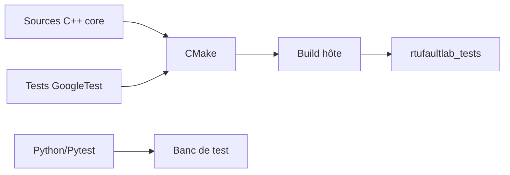

# Phase 0 - Mise en place de l'environnement et de la structure

**Statut** : ✅ Validée
**Jalon** : M0 — Specification

---

## 🎯 Objectif

Mettre en place l'environnement de développement pour RTU-FaultLab : compilateur C++, CMake, GoogleTest, Python/Pytest, et la structure de projet portable (cœur firmware + adapters + banc de test).



---

## 🧰 Outils requis

### Sur PC (Windows / Linux)
- **CMake** >= 3.16
- **GCC/Clang** (MSYS2/MinGW sur Windows, gcc sur Linux) >= 13
- **GoogleTest** (récupéré par CMake via FetchContent)
- **Python 3** >= 3.10 + `pytest`, `pyyaml`, `pyserial` (option)
- **clang-format**, **clang-tidy** / **cppcheck** (qualité)
- **Git**

### Pour STM32 (phase 10+)
- **arm-none-eabi-gcc** (toolchain ARM)
- **STM32CubeMX** (génération HAL)
- **ST-Link / OpenOCD** (flashage)

---

## 📁 Structure du projet cible

```
RTU-FaultLab/
├── firmware/
│   ├── core/            # Cœur portable C++17 (parser, registres, sécurité)
│   ├── host/            # Adapter hôte (transport virtuel, GPIO mock, horloge)
│   └── stm32/           # Adapter STM32 (HAL UART, GPIO, FreeRTOS) — phase 10
├── tests/
│   ├── unit/            # Tests GoogleTest (C++)
│   └── integration/     # Tests Python/Pytest (campagnes)
├── bench/
│   ├── runner/          # CLI Python, moteur d'injection de défauts
│   ├── campaigns/       # Scénarios YAML
│   └── reports/         # JUnit/JSON/HTML
├── docs/                # Documentation par phase + spec
├── CMakeLists.txt
├── .clang-format
└── README.md
```

---

## 🔧 Installation (Windows / MSYS2)

```bash
pacman -S mingw-w64-x86_64-gcc mingw-w64-x86_64-cmake mingw-w64-x86_64-ninja
pip install pytest pyyaml pyserial
```

Vérification :
```bash
gcc --version
cmake --version
python --version
```

---

## 🏗️ Compilation (hôte)

```bash
cmake -G "MSYS Makefiles" -S . -B build
cmake --build build
```

Cross-build STM32 (phase 10+) :
```bash
cmake -G "MSYS Makefiles" -DCMAKE_TOOLCHAIN_FILE="firmware/stm32/toolchain-arm.cmake" -DCROSS_COMPILE=ON -S . -B build_stm32
cmake --build build_stm32
```

---

## 🧪 Tests

```bash
cd build && ./rtufaultlab_tests.exe
cd bench && python -m pytest
```

---

## ✅ Checklist de validation

- [ ] Compilateur, CMake, Python opérationnels
- [ ] Structure de dossiers créée
- [ ] Build hôte vide passe
- [ ] Tests hôte vides passent
- [ ] `.clang-format` en place

---

## 📚 Ce qu'on apprend

- CMake multi-cibles (host / cross)
- Séparation core / adapter (portabilité)
- Environnement de test bicéphale (C++ + Python)

---

*Règle d'or : ne passer à la phase suivante sans valider la checklist.*