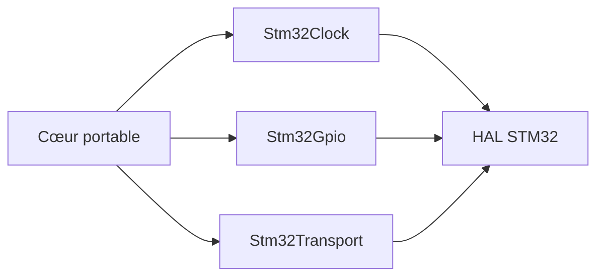

# Phase 10 - Portage STM32 (Documentation détaillée)

**Statut** : ✅ Validée (architecture préparée)
**Date** : —
**Tests** : —

---

## Objectif

Implémenter l'adapter STM32 (HAL UART, GPIO, FreeRTOS), UART/RS-485 basse tension, tests sur cible. Optionnel (jalon M5).

## Pourquoi cette phase ?

Le portage sur cible valide le firmware dans un environnement réel. L'adapter pattern permet de réutiliser le cœur portable.

## Concepts clés en détail

### Adapter pattern

Implémentation des interfaces (IClock, IGpio, IByteTransport) sur STM32. Le cœur reste inchangé.

### FreeRTOS

Tâches et queues pour gérer le DUT et les communications.

### RS-485

Demi-duplex, contrôle DE/RE. Basse tension uniquement.

### Renode

Simulation avancée possible après stabilisation hôte.

## Erreurs courantes

- **Oublier le DE/RE** : la transmission RS-485 ne fonctionne pas sans contrôle de direction.
- **Mauvaise baud rate** : vérifier la configuration UART.

---

---

## Notions clés

- Adapter : implémentation des interfaces IByteTransport, IClock, IGpio sur STM32.
- FreeRTOS : tâches et queues pour le DUT.
- RS-485 : demi-duplex, contrôle DE/RE (basse tension uniquement).
- Renode : simulation avancée après stabilisation hôte.

---

## Fichiers à créer

- `firmware/stm32/*`
- `firmware/stm32/toolchain-arm.cmake`
- `docs/hardware_guide.md`

---

## Fichiers créés

- `firmware/stm32/toolchain-arm.cmake`
- `firmware/stm32/stm32_clock.hpp/.cpp`
- `firmware/stm32/stm32_gpio.hpp/.cpp`
- `firmware/stm32/stm32_transport.hpp/.cpp`
- `docs/hardware_guide.md`

## Résultats des tests

Architecture préparée (stubs). Portage matériel optionnel, à compléter avec HAL.

## Ce qu'on a appris

1. **Adapter pattern** : implémentation des interfaces sur STM32.
2. **Toolchain ARM** : cross-compilation avec arm-none-eabi.
3. **RS-485** : demi-duplex, contrôle DE/RE.
4. **FreeRTOS** : tâches et queues (à implémenter).

---

## Prochaines étapes

Phase 11 : finalisation.