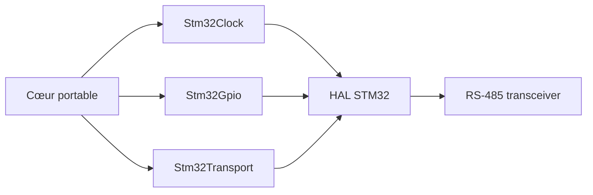

# Phase 10 - Portage STM32 / FreeRTOS et adapter HAL

**Statut** : ✅ Validée (architecture préparée)
**Objectif** : Implémenter l'adapter STM32 : HAL UART, GPIO, FreeRTOS, UART/RS-485 basse tension, tests sur cible (jalon M5, optionnel).

---

## 🧠 Notions clés

- **Adapter** : implémentation des interfaces (IByteTransport, IClock, IGpio) sur STM32.
- **FreeRTOS** : tâches et queues.
- **RS-485** : demi-duplex, contrôle DE/RE.

---

## 🛠️ Étapes à réaliser

1. Toolchain ARM + CMake cross.
2. Drivers STM32 UART/GPIO.
3. Implémentation des interfaces core.
4. Tâche FreeRTOS pour le DUT.
5. Guide de câblage basse tension.
6. Tests sur cible + rapport.

---

## ✅ Checklist de validation

- [ ] Cross-build réussi
- [ ] Adapter implémente les interfaces
- [ ] UART/RS-485 fonctionnel (basse tension)
- [ ] Tests sur cible documentés
- [ ] Rapport de validation matériel

---

## 📁 Fichiers à créer/modifier

| Fichier | Action |
|---|---|
| `firmware/stm32/*` | Créer |
| `firmware/stm32/toolchain-arm.cmake` | Créer |
| `docs/hardware_guide.md` | Créer |