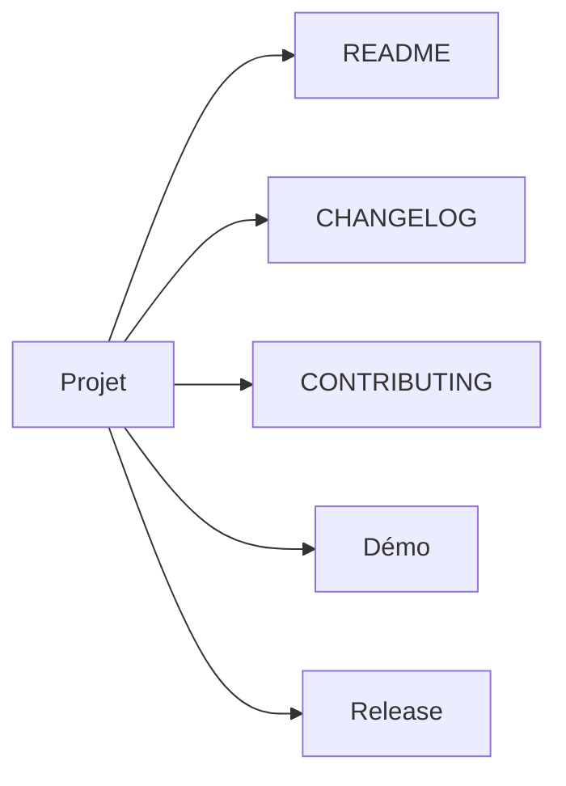

# Phase 11 - Finalisation (Documentation détaillée)

**Statut** : ✅ Validée
**Date** : —
**Tests** : —

---

## Objectif

Finaliser le projet : README, CHANGELOG, démonstration, vérification des critères d'acceptation MVP, release.

## Pourquoi cette phase ?

La finalisation rend le projet présentable et utilisable par d'autres. La documentation claire est essentielle pour le portfolio.

## Concepts clés en détail

### Release candidate

Build + tests + rapports reproductibles. Vérification des critères d'acceptation MVP.

### Documentation

README, CHANGELOG, CONTRIBUTING. Distinction claire entre SIL et matériel.

### Démonstration

Campagne nominale + campagne avec défauts. Montre la valeur du projet.

## Erreurs courantes

- **Oublier les limites** : ne pas prétendre à une certification.
- **Documentation incomplète** : le README doit suffire pour démarrer.

---



---

## Critères d'acceptation MVP (rappel)

- Clone neuf compile et teste sur Linux/Windows sans matériel.
- FC03 et FC06 gérés selon spec.
- Aucune trame invalide ne modifie l'état des sorties.
- Heartbeat expiré force OFF (horloge contrôlée).
- TC-001..TC-014 implémentés ou justifiés.
- Injection CRC/perte/duplication/retard avec seed conservée.
- Rapports JUnit XML + JSON générés ; matrice consultable.
- CI bloque PR si build/tests/format/analyse échouent.
- README clair sur simulé vs matériel.

---

## Fichiers à créer

- `README.md`
- `CHANGELOG.md`
- `CONTRIBUTING.md`

---

## Fichiers créés

- `README.md`
- `CHANGELOG.md`
- `CONTRIBUTING.md`
- `bench/demo.py`

## Résultats des tests

```
cmake --build build
.\rtufaultlab_tests.exe   # 27/27 PASSED
python -m pytest tests/integration  # passed
```

## Ce qu'on a appris

1. **Documentation** : README, CHANGELOG, CONTRIBUTING.
2. **Release candidate** : build + tests + rapports reproductibles.
3. **Distinction SIL/matériel** : clairement documentée.

---

## Conclusion

Le projet est livrable comme portfolio : firmware C++ portable, banc Python, injection de défauts déterministe, traçabilité et CI.