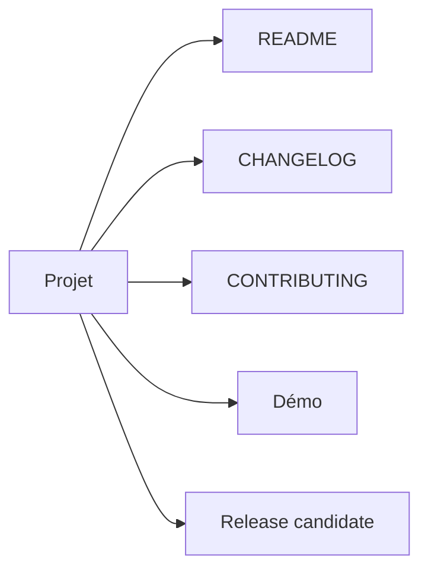

# Phase 11 - Finalisation, documentation et démonstration

**Statut** : ✅ Validée
**Objectif** : Finaliser le projet : README, CHANGELOG, CONTRIBUTING, démo, release candidate reproductible, documentation SIL vs matériel.

---

## 🧠 Notions clés

- **Release candidate** : build + tests + rapports reproductibles.
- **Documentation** : distinguer simulé vs matériel.
- **Démonstration** : campagne nominale + campagne avec défauts.

---

## 🛠️ Étapes à réaliser

1. README complet (installation, usage, limites).
2. CHANGELOG et guide de contribution.
3. Démonstration (terminal ou vidéo).
4. Vérification des critères d'acceptation MVP.
5. Tag de release.

---

## ✅ Checklist de validation

- [ ] Clone neuf compile et teste (Linux/Windows)
- [ ] TC-001..TC-014 couverts ou justifiés
- [ ] Rapports JUnit/JSON générés
- [ ] CI bloque les PR défaillantes
- [ ] README clair sur simulé vs matériel

---

## 📁 Fichiers à créer/modifier

| Fichier | Action |
|---|---|
| `README.md` | Créer/Modifier |
| `CHANGELOG.md` | Créer |
| `CONTRIBUTING.md` | Créer |