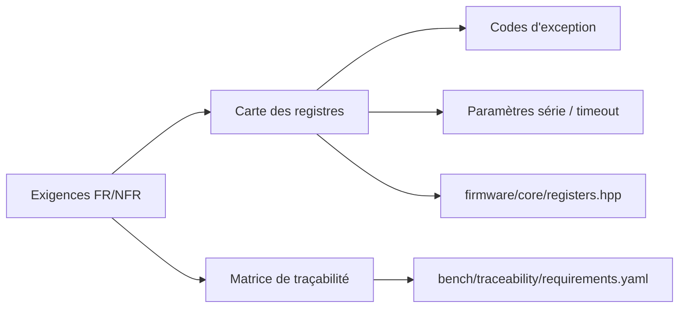
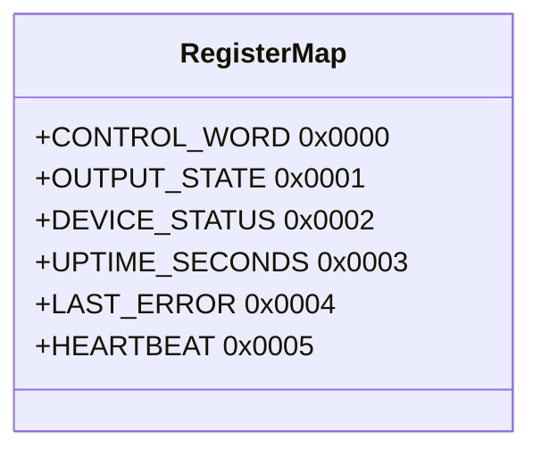

# Phase 1 - Spécification et carte des registres (Documentation détaillée)

**Statut** : ✅ Validée
**Date** : —
**Tests** : —

---

## 📋 Table des matières

1. [Objectif](#objectif)
2. [Exigences](#exigences)
3. [Carte des registres](#carte-des-registres)
4. [Fichiers à créer](#fichiers-à-créer)
5. [Checklist](#checklist)
6. [Prochaines étapes](#prochaines-étapes)

---

## Objectif

Finaliser la spécification fonctionnelle et technique : exigences FR/NFR, carte des registres, codes d'exception, paramètres série et timeout, matrice de traçabilité initiale. Gate M0.

## Pourquoi cette phase ?

Avant d'écrire du code, il faut définir précisément ce que le système doit faire. Les exigences servent de contrat entre le développeur et le validateur. La carte des registres est la "source de vérité" partagée entre le firmware et les tests.

## Concepts clés en détail

### Exigences fonctionnelles vs non fonctionnelles

- **FR (Functional Requirement)** : comportement observable (ex. "FC03 lit les registres").
- **NFR (Non-Functional Requirement)** : qualités (portabilité, bornes, déterminisme).

### Carte des registres comme source unique

Les adresses sont définies dans `firmware/core/registers.hpp` et utilisées par le firmware et les tests. Cela évite les divergences.

### Traçabilité

La matrice `requirements.yaml` lie chaque exigence à des cas de test. Elle sera enrichie au fil des phases.

## Erreurs courantes

- **Oublier les bits réservés** : toujours valider les bits non utilisés.
- **Ne pas documenter le timeout** : le heartbeat doit être configurable et testé.

---

## Architecture

---

## Exigences

### Fonctionnelles (FR-001..FR-013)
Reprises du cahier des charges : parsing campagne, analyse trame, FC03, FC06, exceptions, sorties OFF au boot/timeout, injection de défauts, reproductibilité, oracles, rapports, traçabilité, transport série, enveloppe IPC.

### Non fonctionnelles (NFR-001..NFR-008)
Portabilité, buffer borné 256 octets, déterminisme, qualité de code, exécution sans matériel, horloge injectable, CI, distinction SIL/matériel.

---

## Carte des registres

| Adresse | Nom | Accès | Sémantique |
|---|---|---|---|
| 0x0000 | CONTROL_WORD | R/W (FC06) | Bit0 sortie1 ; bit1 sortie2 ; autres bits rejetés |
| 0x0001 | OUTPUT_STATE | RO (FC03) | Image des sorties appliquées (bits 0/1) |
| 0x0002 | DEVICE_STATUS | RO (FC03) | Bit0 READY ; bit1 SAFE_TIMEOUT ; bit2 PROTOCOL_ERROR ; bit3 RESET_CAUSE |
| 0x0003 | UPTIME_SECONDS | RO (FC03) | Compteur monotone (modulo/saturation documenté) |
| 0x0004 | LAST_ERROR | RO (FC03) | Code dernière erreur diagnostique |
| 0x0005 | HEARTBEAT | WO (FC06) | Écriture séquencée, rafraîchit le délai de sécurité |

Paramètres série par défaut : 19200 bit/s, 8E1. Timeout heartbeat : 1000 ms (configurable, horloge injectée).

---

## Fichiers à créer

- `docs/SPEC.md`
- `firmware/core/registers.hpp`
- `bench/traceability/requirements.yaml`

---

## Prochaines étapes

Phase 2 : implémenter CRC, parser et FC03/FC06.