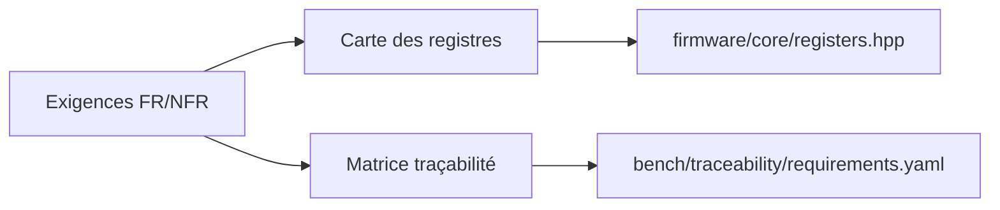

# Phase 1 - Spécification et carte des registres

**Statut** : ✅ Validée
**Objectif** : Finaliser les exigences (FR/NFR), la carte des registres, les comportements de sécurité et la matrice de traçabilité initiale (jalon M0).

---

## 🧠 Notions clés

- **Exigence fonctionnelle (FR)** : comportement observable à vérifier.
- **Exigence non fonctionnelle (NFR)** : portabilité, bornes, déterminisme, qualité.
- **Carte des registres** : adresses Modbus documentées, source unique partagée tests/docs.
- **Traçabilité** : requirement_id → test_case_id → résultat.

---

## 🛠️ Étapes à réaliser

1. Rédiger/valider `docs/SPEC.md` (comportement, registres, exceptions).
2. Centraliser les adresses/valeurs dans `firmware/core/registers.hpp` (enum/const).
3. Définir les codes d'erreur Modbus et de diagnostic.
4. Établir la matrice exigences ↔ tests (`bench/traceability/requirements.yaml`).
5. Documenter les paramètres série par défaut (19200, 8E1) et timeout heartbeat (1000 ms).

---

## ✅ Checklist de validation

- [ ] Exigences FR-001..FR-013 et NFR-001..NFR-008 listées
- [ ] Carte des 6 registres (0x0000..0x0005) documentée
- [ ] Codes d'exception Modbus définis
- [ ] Matrice traçabilité initiale créée
- [ ] Revue des exigences approuvée (gate M0)

---

## 📁 Fichiers à créer/modifier

| Fichier | Action |
|---|---|
| `docs/SPEC.md` | Créer |
| `firmware/core/registers.hpp` | Créer |
| `bench/traceability/requirements.yaml` | Créer |
| `README.md` | Modifier (périmètre SIL/matériel) |