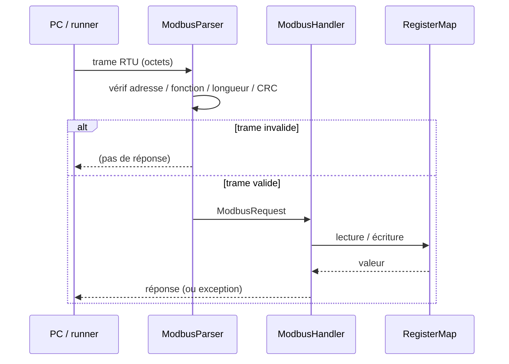
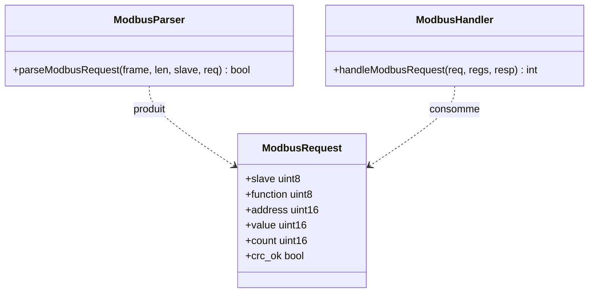

# Phase 2 - Cœur Modbus RTU (Documentation détaillée)

**Statut** : ✅ Validée
**Date** : —
**Tests** : —

---

## Objectif

Implémenter le cœur Modbus RTU portable : CRC-16/Modbus, validation de trame (adresse, fonction, longueur, CRC), FC03 et FC06, exceptions. Aucune dépendance hardware.

## Pourquoi cette phase ?

Le parser Modbus est le cœur de la communication. Toute erreur de validation peut entraîner des comportements non sûrs. Il doit être portable et testable sans matériel.

## Concepts clés en détail

### CRC-16/Modbus

Polynôme 0xA001, init 0xFFFF. Les octets sont traités du premier au dernier. Le CRC est envoyé en little-endian (octet bas puis octet haut).

### Validation de trame

Ordre des vérifications :
1. Longueur minimale (8 octets) et maximale (256).
2. Adresse esclave correspondante.
3. CRC valide.
4. Fonction supportée.
5. Adresse de registre valide.

### Exceptions Modbus

- 0x01 : fonction illégale.
- 0x02 : adresse de données illégale.
- 0x03 : valeur de données illégale.

La réponse d'exception est : `[slave][func|0x80][exc_code][CRC]`.

## Erreurs courantes

- **CRC calculé sur toute la trame** : il faut exclure les 2 octets CRC.
- **Oublier le cas slave mismatch** : ne pas répondre si l'adresse ne correspond pas.
- **Traitement partiel** : ne jamais modifier l'état si la trame est invalide.

---

## Architecture





```
IByteTransport --> ModbusParser --> ModbusHandler --> RegisterMap
                       |                  |
                       +-- CRC check      +-- exceptions
```

---

## Notions clés

- CRC-16/Modbus : polynôme 0xA001, init 0xFFFF, réflexion entrée/sortie.
- Trame : [addr][func][data...][crc_lo][crc_hi].
- Exception : fonction | 0x80 + code (01 illegal function, 02 illegal data address, 03 illegal data value).
- Buffer fixe 256 octets, vérification des bornes.

---

## Fichiers à créer

- `firmware/core/modbus_crc.hpp/.cpp`
- `firmware/core/modbus_frame.hpp`
- `firmware/core/modbus_parser.hpp/.cpp`
- `firmware/core/modbus_handler.hpp/.cpp`
- `tests/unit/test_modbus_crc.cpp`
- `tests/unit/test_modbus_parser.cpp`

---

## Tests prévus

- TC-002 : CRC invalide → rejet, sorties inchangées.
- TC-003 : trame tronquée/longueur incohérente → pas de traitement partiel.
- TC-004 : adresse esclave différente → aucune réponse.
- TC-005 : fonction non supportée → exception fonction illégale.

---

## Fichiers créés

- `firmware/core/modbus_crc.hpp/.cpp`
- `firmware/core/modbus_frame.hpp`
- `firmware/core/modbus_parser.hpp/.cpp`
- `firmware/core/modbus_handler.hpp/.cpp`
- `tests/unit/test_modbus_crc.cpp`
- `tests/unit/test_modbus_parser.cpp`

## Résultats des tests

```
[==========] Running 15 tests from 5 test suites.
[  PASSED  ] 15 tests.
```

Tests couverts : CRC (vecteur connu, vide), parser (FC03 valide, CRC invalide, tronqué, mauvais esclave), handler (FC03 lecture, FC06 registre RO, bits réservés, fonction non supportée).

## Ce qu'on a appris

1. **CRC-16/Modbus** : polynôme 0xA001, init 0xFFFF, octets LSB en premier.
2. **Validation de trame** : adresse, fonction, longueur, CRC avant traitement.
3. **Exceptions Modbus** : fonction | 0x80 + code (01/02/03).
4. **Buffer borné** : 256 octets max, vérification des bornes.
5. **Handler** : dispatch par fonction, validation d'adresse et de valeur.

---

## Prochaines étapes

Phase 3 : carte des registres et handlers (RegisterMap, uptime, last_error, heartbeat).