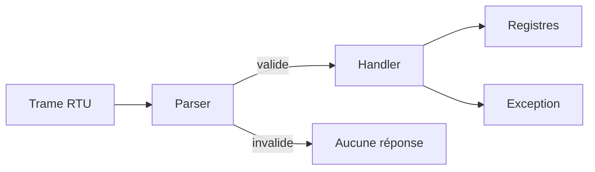

# Phase 2 - Cœur Modbus RTU (CRC, parser, FC03/FC06, exceptions)

**Statut** : ✅ Validée
**Objectif** : Implémenter le parser Modbus RTU portable : validation adresse/fonction/longueur/CRC, FC03 Read Holding Registers, FC06 Write Single Register, exceptions (jalon M1).

---

## 🧠 Notions clés

- **CRC-16/Modbus** : polynôme 0xA001, init 0xFFFF.
- **Trame RTU** : [adresse][fonction][données][CRC low][CRC high].
- **Exception Modbus** : fonction | 0x80 + code exception.
- **Buffer borné** : 256 octets max, aucun accès hors limites.

---

## 🛠️ Étapes à réaliser

1. `modbus_crc.hpp/.cpp` — calcul CRC.
2. `modbus_frame.hpp` — structure de trame bornée.
3. `modbus_parser.hpp/.cpp` — validation et décodage.
4. `modbus_handler.hpp/.cpp` — dispatch FC03/FC06, exceptions.
5. Tests GoogleTest : trames valides/invalides, CRC, longueurs, adresses.

---

## ✅ Checklist de validation

- [ ] CRC correct sur trames de référence
- [ ] FC03 lit les registres documentés
- [ ] FC06 écrit uniquement registres modifiables/valeurs autorisées
- [ ] Exceptions pour fonction/adresse/valeur illégales
- [ ] Aucune écriture partielle sur erreur
- [ ] Tests unitaires verts

---

## 📁 Fichiers à créer/modifier

| Fichier | Action |
|---|---|
| `firmware/core/modbus_crc.hpp/.cpp` | Créer |
| `firmware/core/modbus_frame.hpp` | Créer |
| `firmware/core/modbus_parser.hpp/.cpp` | Créer |
| `firmware/core/modbus_handler.hpp/.cpp` | Créer |
| `tests/unit/test_modbus_crc.cpp` | Créer |
| `tests/unit/test_modbus_parser.cpp` | Créer |