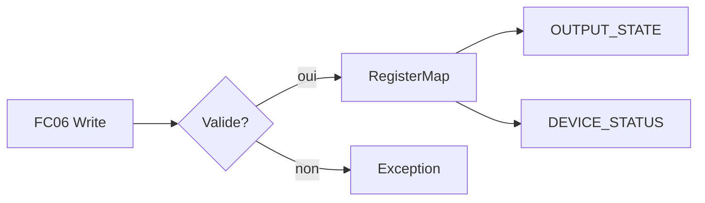

# Phase 3 - Carte des registres et handlers (Documentation détaillée)

**Statut** : ✅ Validée
**Date** : —
**Tests** : —

---

## Objectif

Implémenter la carte des registres et la logique de commandes FC03/FC06, avec validation des bits réservés et gestion des registres RO.

## Pourquoi cette phase ?

La carte des registres est l'interface applicative du firmware. Elle doit être cohérente avec la spécification et protéger contre les écritures illégales.

## Concepts clés en détail

### Registres en lecture seule (RO)

Les registres OUTPUT_STATE, DEVICE_STATUS, UPTIME_SECONDS, LAST_ERROR sont RO. Toute tentative d'écriture est rejetée par exception.

### Bits réservés

CONTROL_WORD n'utilise que les bits 0 et 1. Les bits 2–15 sont réservés et rejetés.

### Uptime

Compteur monotone incrémenté par tick. Saturation à 0xFFFF pour éviter le débordement.

### Idempotence

Dupliquer une écriture identique ne doit pas produire d'effet supplémentaire.

## Erreurs courantes

- **Oublier de mettre à jour OUTPUT_STATE** : après écriture de CONTROL_WORD, l'image des sorties doit être mise à jour.
- **Ne pas réinitialiser LAST_ERROR** : remettre à 0 (NONE) après une écriture réussie.



---

## Notions clés

- Registre RO : écriture rejetée par exception (02 ou 03 selon cas).
- CONTROL_WORD : uniquement bits 0 et 1 ; bits réservés → rejet (TC-007).
- UPTIME : compteur monotone, saturation ou modulo documenté.
- LAST_ERROR : code de la dernière erreur diagnostique.
- Idempotence : duplication d'écriture identique sans effet supplémentaire (TC-009).

---

## Fichiers à créer

- `firmware/core/register_map.hpp/.cpp`
- `firmware/core/command_handler.hpp/.cpp`
- `tests/unit/test_registers.cpp`

---

## Tests prévus

- TC-001 : lecture registre existant FC03.
- TC-006 : écriture registre RO → exception, état inchangé.
- TC-007 : CONTROL_WORD avec bits réservés → rejet.

---

## Fichiers créés

- `firmware/core/register_map.hpp/.cpp`
- `tests/unit/test_registers.cpp`

## Résultats des tests

```
[==========] Running 21 tests from 6 test suites.
[  PASSED  ] 21 tests.
```

Tests couverts : boot SAFE, écriture CONTROL_WORD, bits réservés rejetés, registre RO rejeté, incrément uptime, reset.

## Ce qu'on a appris

1. **RegisterMap** : encapsulation du tableau de registres avec validation.
2. **Bits réservés** : rejet si positionnés (CONTROL_WORD).
3. **Registres RO** : écriture rejetée via exception/adresse.
4. **Uptime** : compteur monotone avec saturation.
5. **Reset** : retour à l'état SAFE.

---

## Prochaines étapes

Phase 4 : machine à états et sécurité.