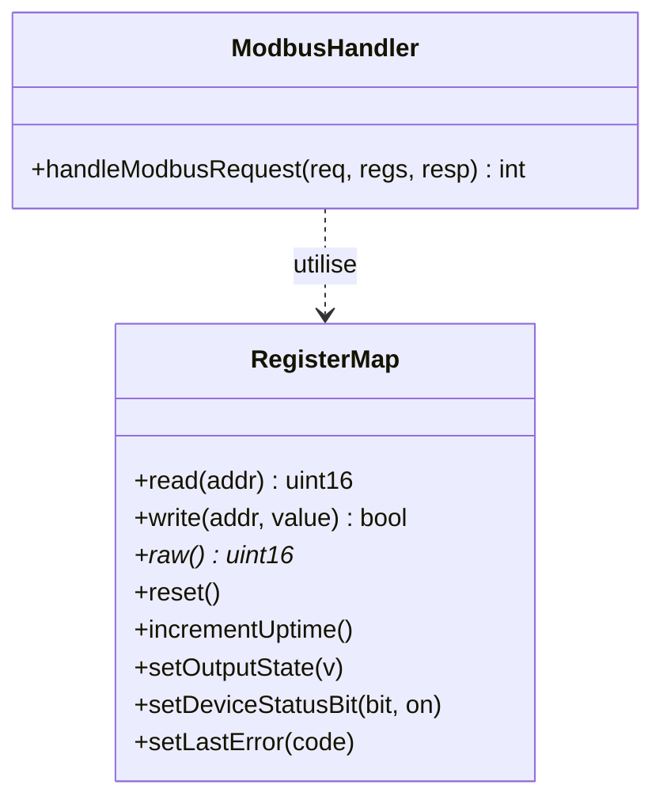

# Phase 3 - Carte des registres et handlers de commandes

**Statut** : ✅ Validée
**Objectif** : Implémenter la carte des registres (CONTROL_WORD, OUTPUT_STATE, DEVICE_STATUS, UPTIME_SECONDS, LAST_ERROR, HEARTBEAT) et les handlers FC03/FC06 avec validation des bits réservés (jalon M1).

---

## 🧠 Notions clés

- **Registre en lecture seule (RO)** : rejet en écriture via exception.
- **Bits réservés** : rejet si positionnés.
- **Idempotence** : duplication d'écriture identique sans effet supplémentaire.

---

## 🛠️ Étapes à réaliser

1. `register_map.hpp/.cpp` — stockage typé des registres.
2. `command_handler.hpp/.cpp` — logique FC03/FC06 par adresse.
3. Validation CONTROL_WORD (bits 0/1 uniquement).
4. Compteur d'uptime monotone (modulo/saturation documenté).
5. LAST_ERROR mis à jour sur erreur de protocole.
6. Tests : lecture de chaque registre, limites d'adresse, bits réservés.

---

## ✅ Checklist de validation

- [ ] FC03 sur 0x0000..0x0005 renvoie valeurs cohérentes
- [ ] FC06 sur 0x0000 accepte bits 0/1, rejette autres
- [ ] FC06 sur registres RO renvoie exception
- [ ] UPTIME monotone
- [ ] LAST_ERROR mis à jour
- [ ] Tests verts

---

## 📁 Fichiers à créer/modifier

| Fichier | Action |
|---|---|
| `firmware/core/register_map.hpp/.cpp` | Créer |
| `firmware/core/command_handler.hpp/.cpp` | Créer |
| `tests/unit/test_registers.cpp` | Créer |