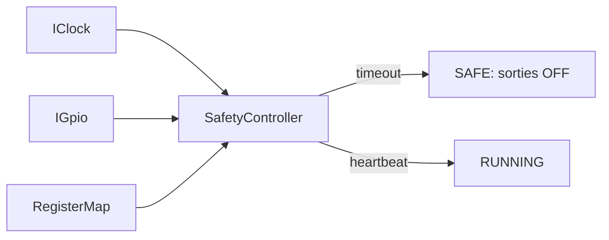

# Phase 4 - Machine à états et sécurité (Documentation détaillée)

**Statut** : ✅ Validée
**Date** : —
**Tests** : —

---

## Objectif

Implémenter le contrôleur de sécurité : démarrage SAFE (sorties OFF), heartbeat timeout 1000 ms, passage OFF à expiration, status bits, récupération selon règle explicite.

## Pourquoi cette phase ?

La sécurité fonctionnelle est essentielle. Le firmware doit revenir à un état sûr en cas de perte de communication. Le heartbeat permet de détecter l'absence du maître.

## Concepts clés en détail

### État SAFE

Sorties OFF par défaut. Aucune sortie activée par trame invalide.

### Heartbeat

Écriture séquencée sur le registre 0x0005. Rafraîchit la fenêtre d'autorisation de commande.

### Horloge injectée (IClock)

Permet de tester le timeout sans sleep réel. L'horloge est contrôlée par le test.

### Status bits

- READY : système prêt.
- SAFE_TIMEOUT : expiration du heartbeat.
- PROTOCOL_ERROR : erreur de protocole.
- RESET_CAUSE : reset logiciel.

## Erreurs courantes

- **Utiliser une horloge réelle dans les tests** : rend les tests non déterministes.
- **Oublier de réinitialiser les sorties** : toujours passer par applySafe().

---



---

## Architecture

```
IClock (injectable) --> SafetyController --> IGpio (sorties virtuelles)
        ^                       |
        |                       +-- DEVICE_STATUS bits
Heartbeat (FC06 0x0005)
```

---

## Notions clés

- SAFE : sorties OFF par défaut (boot et expiration).
- Heartbeat : écriture séquencée rafraîchit la fenêtre d'autorisation.
- IClock : interface d'horloge injectable (tests déterministes, pas de sleep réel).
- IGpio : interface de sorties (mock hôte).
- DEVICE_STATUS : bit0 READY, bit1 SAFE_TIMEOUT, bit2 PROTOCOL_ERROR, bit3 RESET_CAUSE.

---

## Fichiers à créer

- `firmware/core/interfaces/IClock.hpp`
- `firmware/core/interfaces/IGpio.hpp`
- `firmware/core/safety_controller.hpp/.cpp`
- `firmware/host/clock_host.hpp/.cpp`
- `firmware/host/gpio_mock.hpp/.cpp`
- `tests/unit/test_safety.cpp`

---

## Tests prévus

- TC-008 : heartbeat non rafraîchi pendant 1000 ms → SAFE, sorties OFF.
- TC-014 : reset logiciel pendant sorties actives → OFF + status reset.

---

## Fichiers créés

- `firmware/core/interfaces/IClock.hpp`
- `firmware/core/interfaces/IGpio.hpp`
- `firmware/core/safety_controller.hpp/.cpp`
- `firmware/host/clock_host.hpp/.cpp`
- `firmware/host/gpio_mock.hpp/.cpp`
- `tests/unit/test_safety.cpp`

## Résultats des tests

```
[==========] Running 25 tests from 7 test suites.
[  PASSED  ] 25 tests.
```

Tests couverts : boot SAFE, timeout heartbeat, reset, heartbeat maintient les sorties actives.

## Ce qu'on a appris

1. **Interfaces** : IClock et IGpio pour l'injection de dépendances.
2. **SafetyController** : état SAFE, heartbeat, timeout, reset.
3. **Horloge injectée** : tests déterministes sans sleep réel.
4. **GPIO mock** : sorties virtuelles pour les tests.

---

## Prochaines étapes

Phase 5 : transport et DUT hôte.