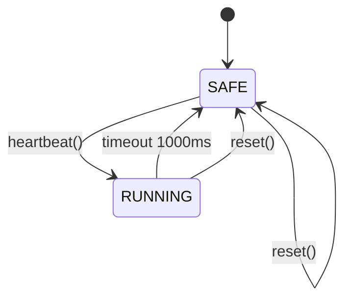

# Phase 4 - Machine à états, sorties virtuelles et sécurité

**Statut** : ✅ Validée
**Objectif** : Implémenter le contrôleur de sécurité : démarrage SAFE (sorties OFF), heartbeat timeout 1000 ms, retour OFF à expiration, récupération selon règle explicite, status bits (jalon M2).

---

## 🧠 Notions clés

- **État sûr (SAFE)** : sorties OFF par défaut.
- **Heartbeat** : écriture séquencée sur registre 0x0005 rafraîchit la fenêtre.
- **Horloge injectée (IClock)** : tests déterministes sans sleep réel.
- **Fail-safe** : aucune sortie activée par trame invalide.

---

## 🛠️ Étapes à réaliser

1. Interface `IClock` + implémentation hôte (horloge simulée).
2. Interface `IGpio` + mock (sorties virtuelles).
3. `safety_controller.hpp/.cpp` — timeout, passage SAFE, status bits.
4. Intégration heartbeat dans command handler.
5. DEVICE_STATUS : READY, SAFE_TIMEOUT, PROTOCOL_ERROR, RESET_CAUSE.
6. Tests : boot, expiration 1000 ms, reset logiciel.

---

## ✅ Checklist de validation

- [ ] Sorties OFF au démarrage
- [ ] Sorties OFF après expiration heartbeat (horloge contrôlée)
- [ ] Status SAFE_TIMEOUT mis à jour
- [ ] Reset logiciel remet sorties OFF + status reset
- [ ] Aucune activation sur trame invalide
- [ ] Tests verts

---

## 📁 Fichiers à créer/modifier

| Fichier | Action |
|---|---|
| `firmware/core/safety_controller.hpp/.cpp` | Créer |
| `firmware/host/clock_host.hpp/.cpp` | Créer |
| `firmware/host/gpio_mock.hpp/.cpp` | Créer |
| `firmware/core/interfaces/IClock.hpp` | Créer |
| `firmware/core/interfaces/IGpio.hpp` | Créer |
| `tests/unit/test_safety.cpp` | Créer |