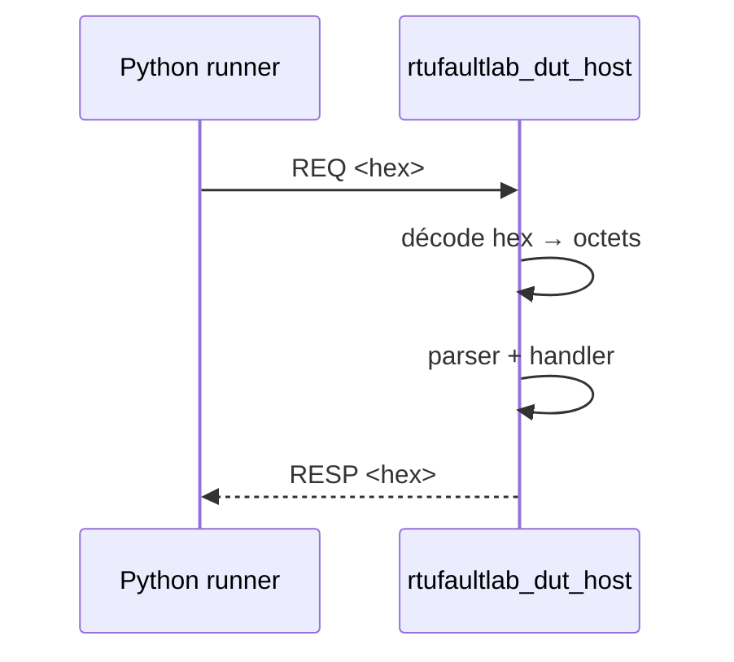

# Phase 5 - Transport et DUT hôte (Documentation détaillée)

**Statut** : ✅ Validée
**Date** : —
**Tests** : —

---

## Objectif

Implémenter l'abstraction de transport, l'adapter hôte (loopback) et le processus `rtufaultlab_dut_host` échangeant des enveloppes hex sur stdin/stdout.

## Pourquoi cette phase ?

Le transport doit être abstrait pour permettre le test sur PC (SIL) et le portage sur cible. L'enveloppe IPC permet de piloter le firmware depuis Python sans matériel.

## Concepts clés en détail

### IByteTransport

Interface commune : loopback (tests), série (PySerial), RS-485 (cible).

### Enveloppe IPC

Format : `REQ <hex>` / `RESP <hex>`. Les octets bruts sont réinjectés dans le parser. Les logs passent sur stderr.

### Silences inter-trame

Gérés par la couche transport avec horloge simulée. Important pour le respect du protocole Modbus.

## Erreurs courantes

- **Mélanger stdout et stderr** : les logs sur stdout corrompent l'enveloppe.
- **Oublier le flush** : le processus DUT doit flusher stdout après chaque réponse.

---



---

## Notions clés

- IByteTransport : interface commune (loopback, série, RS-485).
- Enveloppe IPC : une ligne `REQ <hex>` → réponse `RESP <hex>` ; octets bruts réinjectés dans le parser.
- Logs diagnostic : stderr uniquement (FR-013).
- Silences inter-trame/inter-caractère gérés par la couche transport avec horloge simulée.

---

## Fichiers à créer

- `firmware/core/interfaces/IByteTransport.hpp`
- `firmware/host/transport_loopback.hpp/.cpp`
- `firmware/host/dut_host_main.cpp`
- `tests/unit/test_ipc.cpp`

---

## Tests prévus

- IPC : enveloppes valides, logs sur stderr, erreurs de format.
- Transport loopback : envoi/réception octets.

---

## Fichiers créés

- `firmware/core/interfaces/IByteTransport.hpp`
- `firmware/host/transport_loopback.hpp/.cpp`
- `firmware/host/serial_transport.hpp/.cpp`
- `firmware/host/dut_host_main.cpp`
- `tests/unit/test_ipc.cpp`
- `bench/runner/serial_transport.py`

## Résultats des tests

```
[==========] Running 27 tests from 8 test suites.
[  PASSED  ] 27 tests.
```

DUT host testé manuellement : `REQ 01 03 00 01 00 01 D5 CA` → `RESP 01 03 02 00 00 B8 44`.

## Ce qu'on a appris

1. **IByteTransport** : interface commune pour loopback/série/RS-485.
2. **Enveloppe IPC** : `REQ <hex>` / `RESP <hex>` sur stdin/stdout, octets bruts réinjectés.
3. **Logs diagnostic** : stderr uniquement.
4. **DUT host** : processus C++ pilotable par le runner Python.

---

## Transport série réel

- `SerialTransport` (C++) : implémentation native (Windows CreateFile, Linux termios).
- `serial_transport.py` (Python) : wrapper PySerial (8E1, 19200 bauds par défaut).
- Utilisable pour connecter un DUT matériel (jalon M5).

## Prochaines étapes

Phase 6 : injection de défauts.