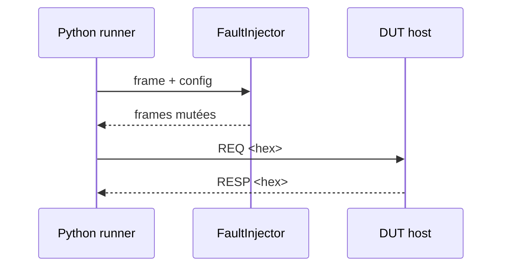

# Phase 6 - Injection de défauts (Documentation détaillée)

**Statut** : ✅ Validée
**Date** : —
**Tests** : —

---

## Objectif

Implémenter le Fault Injection Engine côté banc : mutations déterministes (drop, delay, duplicate, corrupt_crc, truncate) avec journalisation et seed conservée.

## Pourquoi cette phase ?

L'injection de défauts permet de tester la robustesse du firmware de manière reproductible. Sans déterminisme, les tests ne sont pas fiables.

## Concepts clés en détail

### Déterminisme

Utiliser `random.Random(seed)` pour des stimuli reproductibles. Même seed + paramètres = mêmes défauts.

### Mutations

- **drop** : suppression de la trame.
- **delay** : retard de réponse.
- **duplicate** : duplication de la trame.
- **corrupt_crc** : corruption du CRC.
- **truncate** : troncature de la trame.

### Journalisation

Graine, paramètres et mutations appliquées sont consignés pour la traçabilité.

## Erreurs courantes

- **Utiliser random global** : non déterministe. Toujours utiliser une instance seedée.
- **Oublier de journaliser** : impossible de reproduire un défaut sans le journal.

---



---

## Notions clés

- Déterminisme : même seed + paramètres → même série de défauts (FR-008, NFR-003).
- Journal : graine, paramètres, mutations appliquées, stimuli/réponses.
- Injection avant/après transport virtuel.

---

## Fichiers à créer

- `bench/runner/fault_injector.py`
- `bench/runner/transport_virtual.py`
- `tests/integration/test_fault_injection.py`

---

## Tests prévus

- TC-009 : duplication d'écriture identique → idempotent.
- TC-010 : perte de réponse → timeout runner détecté et rapporté.
- TC-011 : retard > timeout → échec classé timeout, pas de blocage.
- TC-012 : même campagne même seed → mêmes défauts.

---

## Fichiers créés

- `bench/runner/fault_injector.py`
- `bench/runner/transport_virtual.py`
- `tests/integration/test_fault_injection.py`

## Résultats des tests

```
python -m pytest tests/integration/test_fault_injection.py
5 passed in 0.03s
```

Tests couverts : reproductibilité, drop, corruption CRC visible, duplication, troncature.

## Ce qu'on a appris

1. **Déterminisme** : random.Random(seed) pour des stimuli reproductibles.
2. **Mutations** : drop, delay, duplicate, corrupt_crc, truncate.
3. **Journalisation** : seed, params, mutations dans FaultLog.
4. **Transport virtuel** : pilotage du processus DUT via subprocess.

---

## Prochaines étapes

Phase 7 : runner et campagnes YAML.