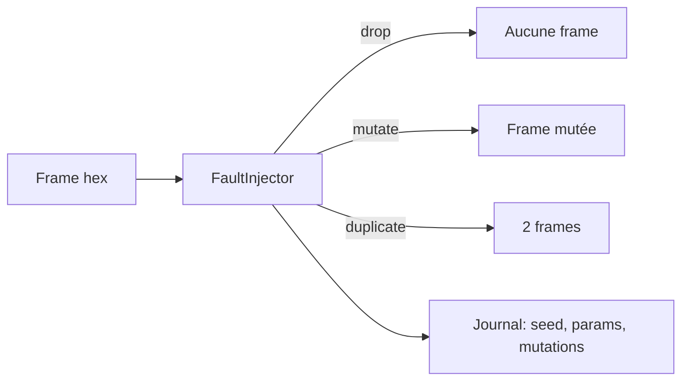

# Phase 6 - Moteur d'injection de défauts déterministe

**Statut** : ✅ Validée
**Objectif** : Implémenter le Fault Injection Engine côté banc Python : suppression, retard, duplication, corruption CRC, déterministe par seed (jalon M3).

---

## 🧠 Notions clés

- **Déterminisme** : même seed + paramètres → mêmes stimuli.
- **Journalisation** : chaque mutation consignée (graine, paramètres).
- **Transport virtuel** : injection avant/après transport.

---

## 🛠️ Étapes à réaliser

1. `bench/runner/fault_injector.py` — mutations déterministes (random seeded).
2. Modes : drop, delay, duplicate, corrupt_crc, truncate.
3. Journal des stimuli/réponses (JSON).
4. Intégration dans le lien DUT.
5. Tests Python : reproductibilité, chaque mutation visible.

---

## ✅ Checklist de validation

- [ ] Suppression/retard/duplication/corruption implémentés
- [ ] Chaque mutation visible dans le journal
- [ ] Reproductibilité à seed identique
- [ ] Tests Python verts

---

## 📁 Fichiers à créer/modifier

| Fichier | Action |
|---|---|
| `bench/runner/fault_injector.py` | Créer |
| `bench/runner/transport_virtual.py` | Créer |
| `tests/integration/test_fault_injection.py` | Créer |