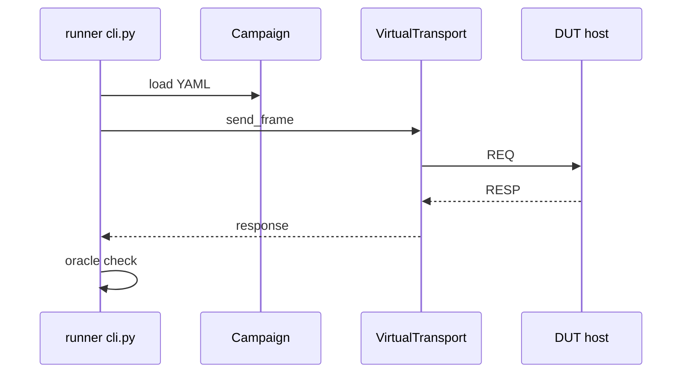

# Phase 7 - Runner et campagnes YAML (Documentation détaillée)

**Statut** : ✅ Validée
**Date** : —
**Tests** : —

---

## Objectif

Développer le runner CLI Python : chargement/validation de campagnes YAML, pilotage du DUT, oracles, exécution TC-001..TC-014.

## Pourquoi cette phase ?

Le runner automatise l'exécution des tests et la vérification des résultats. Il rend les campagnes reproductibles et traçables.

## Concepts clés en détail

### Campagne YAML

Format structuré : id, seed, target, timeout_ms, tests (action, adresse, inject, expect).

### Validation de schéma

Rejet explicite des fichiers mal formés. Évite les erreurs silencieuses.

### Oracles

Vérification de la réponse, de l'état du DUT et des délais. Permet d'automatiser la validation.

## Erreurs courantes

- **Ne pas valider le schéma** : erreurs difficiles à diagnostiquer.
- **Oublier le timeout** : le runner doit ne pas bloquer.

---



---

## Format de campagne (exemple)

```yaml
campaign:
  id: modbus_robustness_smoke
  seed: 481516
  target: virtual_dut
  timeout_ms: 250
  tests:
    - id: TC-001
      requirement: FR-003
      action: read_holding_registers
      address: 0x0001
      count: 1
      expect:
        status: success
    - id: TC-002
      requirement: FR-002
      action: write_single_register
      address: 0x0000
      value: 0x0001
      inject:
        corrupt_crc: true
      expect:
        dut_output_state: 0x0000
```

---

## Notions clés

- Validation de schéma versionné ; rejet explicite si mal formé (FR-001).
- Oracles : réponse, état DUT, délais.
- Rafale de requêtes valides/invalides (TC-013) sans corruption d'état.

---

## Fichiers à créer

- `bench/runner/cli.py`
- `bench/runner/campaign_loader.py`
- `bench/runner/oracle.py`
- `bench/campaigns/smoke.yaml`
- `bench/campaigns/robustness.yaml`
- `tests/integration/test_campaigns.py`

---

## Fichiers créés

- `bench/runner/campaign_loader.py`
- `bench/runner/oracle.py`
- `bench/runner/cli.py`
- `bench/campaigns/smoke.yaml`
- `bench/campaigns/robustness.yaml`
- `tests/integration/test_campaigns.py`

## Résultats des tests

```
python -m pytest tests/integration/test_campaigns.py
3 passed in 0.87s
```

## Ce qu'on a appris

1. **Campagne YAML** : chargement et validation de schéma.
2. **Oracles** : vérification réponse, état DUT, délais.
3. **Runner CLI** : argparse, exécution bout-en-bout.
4. **Communication processus** : subprocess avec PATH MinGW.

---

## Prochaines étapes

Phase 8 : rapports et traçabilité.