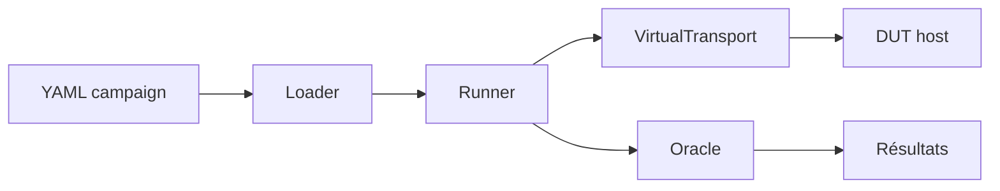

# Phase 7 - Runner Python, campagnes YAML et oracles

**Statut** : ✅ Validée
**Objectif** : Développer le runner CLI qui charge les campagnes YAML, pilote le DUT, vérifie les réponses/états/délais et produit les résultats (jalon M3).

---

## 🧠 Notions clés

- **Campagne YAML** : id, seed, target, timeout_ms, tests (action, adresse, inject, expect).
- **Validation de schéma** : rejet explicite des fichiers mal formés.
- **Oracles** : vérification réponse, état DUT, délais.

---

## 🛠️ Étapes à réaliser

1. `bench/runner/cli.py` (argparse) + loader YAML.
2. Schéma versionné + validation.
3. Exécution des actions (read_holding_registers, write_single_register).
4. Vérification des attentes (status, dut_output_state, timeout).
5. Export des résultats intermédiaires.
6. Campagnes d'exemple : smoke, robustness.

---

## ✅ Checklist de validation

- [ ] Campagne YAML valide chargée
- [ ] Fichier mal formé rejeté avec erreur explicite
- [ ] TC-001..TC-014 implémentés ou justifiés
- [ ] Runner sans blocage sur timeout
- [ ] Tests d'intégration verts

---

## 📁 Fichiers à créer/modifier

| Fichier | Action |
|---|---|
| `bench/runner/cli.py` | Créer |
| `bench/runner/campaign_loader.py` | Créer |
| `bench/runner/oracle.py` | Créer |
| `bench/campaigns/smoke.yaml` | Créer |
| `bench/campaigns/robustness.yaml` | Créer |
| `tests/integration/test_campaigns.py` | Créer |