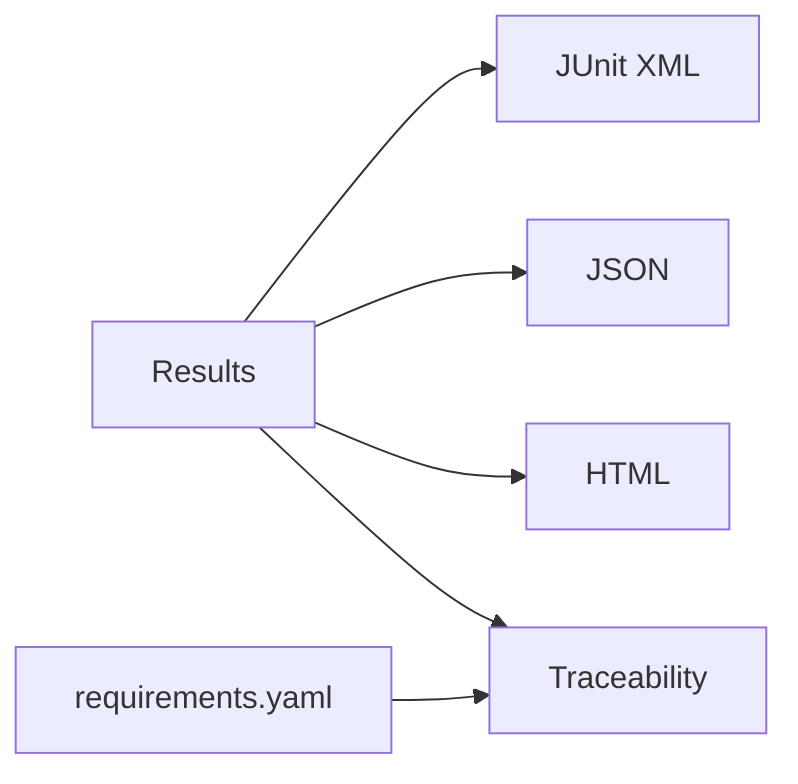

# Phase 8 - Rapports et traçabilité (Documentation détaillée)

**Statut** : ✅ Validée
**Date** : —
**Tests** : —

---

## Objectif

Produire les artefacts de test (JUnit XML, JSON, HTML) et la matrice exigences ↔ tests ↔ résultats.

## Pourquoi cette phase ?

Les rapports sont les preuves de validation. La traçabilité permet de lier chaque exigence à ses tests et résultats.

## Concepts clés en détail

### JUnit XML

Standard pour les outils CI. Permet l'intégration avec GitHub Actions, Jenkins, etc.

### JSON

Données structurées : seed, paramètres transport, résultats par test.

### HTML

Rapport synthétique lisible par un humain.

### Traçabilité

Matrice requirement_id → test_case_id → résultat. Essentielle pour l'IVVQ.

## Erreurs courantes

- **Oublier l'étiquetage SIL/matériel** : distinguer les résultats simulés des résultats matériels.
- **Ne pas inclure la seed** : impossible de reproduire sans la graine.

---

---

## Notions clés

- JUnit XML : standard CI.
- JSON : seed, params transport, résultats par test.
- HTML : rapport synthétique.
- Traçabilité : requirement_id → test_case_id → résultat.
- Étiquetage SIL / hardware dans les rapports (NFR-008).

---

## Fichiers à créer

- `bench/runner/reporters/junit.py`
- `bench/runner/reporters/json_report.py`
- `bench/runner/reporters/html_report.py`
- `bench/runner/traceability.py`

---

## Fichiers créés

- `bench/runner/reporters/junit.py`
- `bench/runner/reporters/json_report.py`
- `bench/runner/reporters/html_report.py`
- `bench/runner/traceability.py`

## Résultats des tests

Rapports générés dans `bench/reports/` : `junit.xml`, `results.json`, `report.html`, `traceability.json`.

## Ce qu'on a appris

1. **JUnit XML** : standard CI, généré via ElementTree.
2. **JSON** : données structurées (seed, params, résultats).
3. **HTML** : rapport synthétique.
4. **Traçabilité** : requirement_id → test_case_id → résultat.

---

## Prochaines étapes

Phase 9 : qualité et CI.