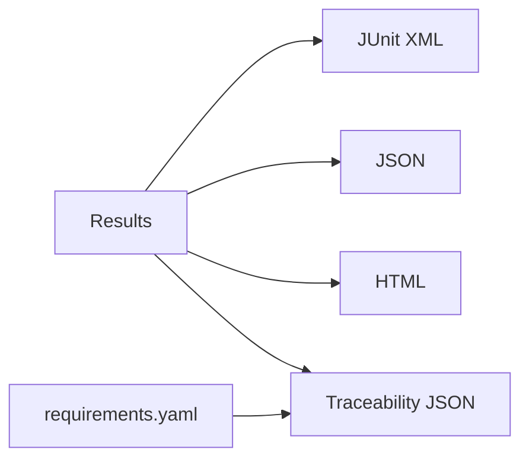

# Phase 8 - Rapports JUnit/JSON/HTML et traçabilité

**Statut** : ✅ Validée
**Objectif** : Produire les artefacts de test (JUnit XML, JSON, HTML) et la matrice exigences ↔ tests ↔ résultats (jalon M4).

---

## 🧠 Notions clés

- **JUnit XML** : standard pour CI.
- **JSON** : données structurées (seed, params, résultats).
- **HTML** : rapport synthétique.
- **Traçabilité** : requirement_id → test_case_id → résultat.

---

## 🛠️ Étapes à réaliser

1. Reporter JUnit XML.
2. Reporter JSON (avec seed/params).
3. Reporter HTML (synthèse).
4. Génération matrice traçabilité.
5. Étiquetage SIL / hardware dans les rapports.

---

## ✅ Checklist de validation

- [ ] JUnit XML généré et lisible
- [ ] JSON généré avec seed/params
- [ ] HTML généré
- [ ] Matrice traçabilité consultable
- [ ] Rapports étiquetés SIL

---

## 📁 Fichiers à créer/modifier

| Fichier | Action |
|---|---|
| `bench/runner/reporters/junit.py` | Créer |
| `bench/runner/reporters/json_report.py` | Créer |
| `bench/runner/reporters/html_report.py` | Créer |
| `bench/runner/traceability.py` | Créer |