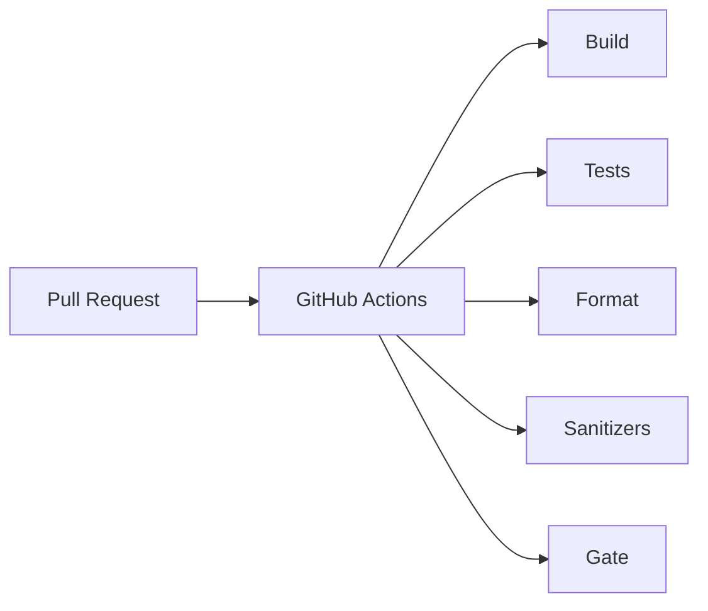

# Phase 9 - Qualité et CI (Documentation détaillée)

**Statut** : ✅ Validée
**Date** : —
**Tests** : —

---

## Objectif

Mettre en place la qualité continue : clang-format, warnings, clang-tidy/cppcheck, sanitizers, GitHub Actions.

## Pourquoi cette phase ?

La qualité continue garantit que le code reste propre et sans régression. Les sanitizers détectent les accès mémoire invalides.

## Concepts clés en détail

### Sanitizers (ASan/UBSan)

Détectent les accès hors limites et le comportement indéfini. Disponibles sur Linux/Clang.

### Analyse statique

clang-tidy et cppcheck détectent les bugs potentiels avant l'exécution.

### CI

GitHub Actions exécute build + tests + format + analyse sur chaque PR.

### Gate

La PR est bloquée si un check échoue.

## Erreurs courantes

- **MinGW sans sanitizers** : utiliser Linux/Clang pour les sanitizers.
- **Oublier le format check** : le code doit être formaté avant merge.

---

---

## Notions clés

- Sanitizers ASan/UBSan : accès hors limites, UB.
- Analyse statique : clang-tidy, cppcheck.
- CI : build host + tests C++ + tests Python + format + analyse sur PR et main.
- Gate : PR bloquée si échec.

---

## Fichiers à créer

- `.clang-format`
- `.github/workflows/ci.yml`
- `CMakeLists.txt` (options sanitizers)

---

## Fichiers créés

- `.github/workflows/ci.yml`
- `.clang-format`

## Analyse statique

- `cppcheck` intégré dans la CI (step dédié).
- Vérifié localement : 0 erreur sur `firmware/` et `tests/`.

## Couverture de code

- Option CMake `RTU_ENABLE_COVERAGE` (gcov).
- Job CI `coverage` sur Linux avec lcov.
- Vérifié localement : `modbus_crc.cpp` à 100%.

## Résultats des tests

Workflow CI défini : build host + tests C++ + tests Python + format + sanitizers (Linux) + smoke campaign.

## Ce qu'on a appris

1. **GitHub Actions** : workflow multi-OS (Windows + Linux).
2. **Sanitizers** : ASan/UBSan sur Linux (MinGW ne les fournit pas ici).
3. **clang-format** : vérification de style en CI.
4. **Gate** : PR bloquée si build/tests/format/analyse échouent.

---

## Prochaines étapes

Phase 10 : portage STM32.